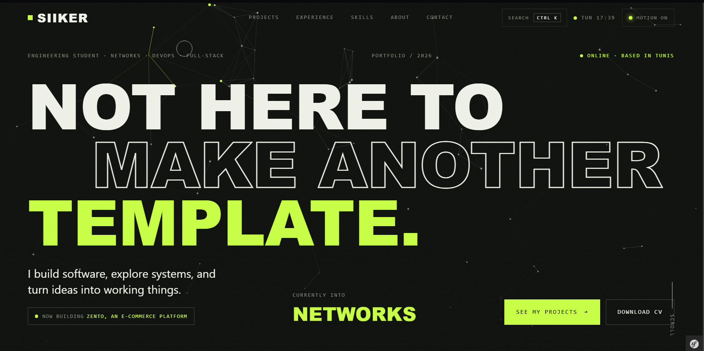
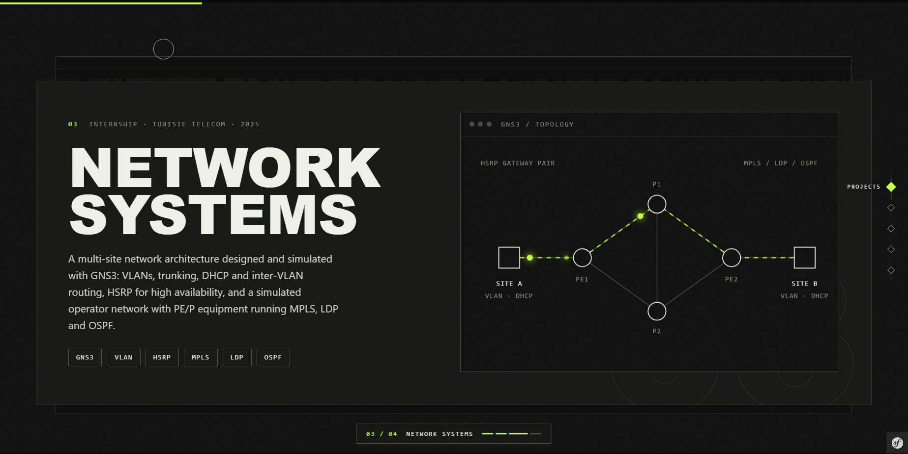
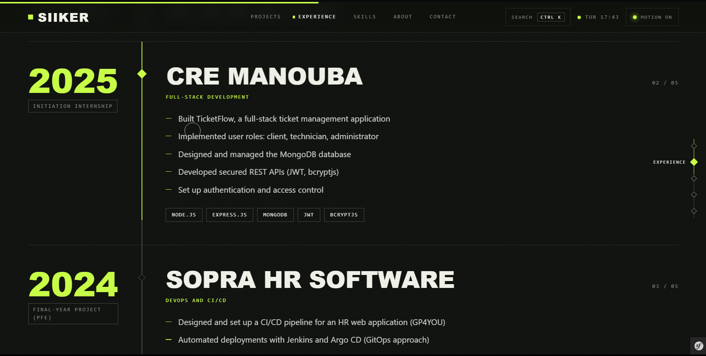
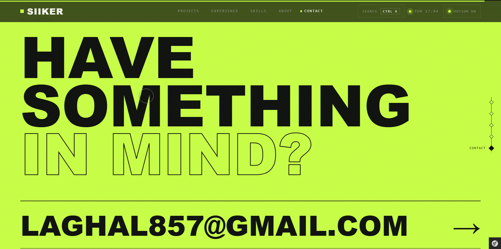


# SIIKER — Networks, DevOps & Full-stack Portfolio

<p align="center">
  
</p>

<p align="center">
  <a href="https://github.com/Siikerloyd"></a>
  <a href="https://www.linkedin.com/in/ben-lagha-mohamed-460444338"></a>
  
  
  
</p>

> **SIIKER** is the personal portfolio of **Ben Lagha Mohamed** — an engineering student in Tunis focused on networks, systems, DevOps and full-stack development. A dark, editorial, motion-first experience built with Symfony + Twig.

---

## ✨ Highlights

- 🎬 **Motion-first UI** — IntersectionObserver reveals, parallax, magnetic buttons, scroll-driven progress, all gated behind a `prefers-reduced-motion` check.
- 🧩 **Four featured projects** + three hands-on infrastructure labs (networking, DevOps, monitoring).
- 📄 **Downloadable CV** served as a static asset.
- 🌐 **Multilingual-ready** routing and translation config.
- ♿ **Accessible by default** — skip link, ARIA labels, keyboard-friendly navigation, reduced-motion fallback.
- ⚡ **Zero build step for assets** — powered by Symfony AssetMapper + Stimulus.

## 📸 Screenshots


| Hero & Intro | Projects |
|:---:|:---:|
|  |  |

| Experience & Skills | Contact |
|:---:|:---:|
|  |  |


---

## 🛠 Tech Stack

| Layer | Technology |
|-------|------------|
| Backend | PHP 8.4+, Symfony 8.1 (Framework, Twig, Asset, Security, Validator, …) |
| Templating | Twig 3 |
| Frontend | Vanilla JS, CSS (custom design system), Stimulus, Turbo |
| Assets | Symfony AssetMapper (no Node/npm build) |
| Database | Doctrine ORM (PostgreSQL by default) |
| Testing | PHPUnit 13 |
| Dev tools | Symfony Web Profiler, Maker Bundle |

---

## 🚀 Getting Started

### Prerequisites

- PHP `>= 8.4` with `ctype` and `iconv`
- Composer
- (Optional) Symfony CLI

### Installation

```bash
git clone https://github.com/Siikerloyd/portfolio.git
cd portfolio

composer install
```

### Run the app

```bash
# With Symfony CLI
symfony serve -d

# Or with PHP built-in server
php -S 127.0.0.1:8000 -t public
```

Then open <http://127.0.0.1:8000>.

### Run tests

```bash
php bin/phpunit
```

---

## 📁 Project Structure

```text
portfolio/
├── assets/              # JS/CSS source (Stimulus controllers, app.css)
├── config/              # Symfony configuration
├── public/              # Web root (index.php, css/, js/, cv/)
├── src/                 # PHP source (controllers, kernel)
├── templates/           # Twig templates (base, home)
├── tests/               # PHPUnit tests
├── translations/        # i18n files
├── var/                 # Cache, logs (git-ignored)
└── vendor/              # Dependencies (git-ignored)
```

---

## 📬 Contact

- **Email:** [laghal857@gmail.com](mailto:laghal857@gmail.com)
- **Phone:** +216 48 028 770
- **GitHub:** [@Siikerloyd](https://github.com/Siikerloyd)
- **LinkedIn:** [Ben Lagha Mohamed](https://www.linkedin.com/in/ben-lagha-mohamed-460444338)
- **CV:** [`public/cv/Ben-Lagha-Mohamed-CV.pdf`](public/cv/Ben-Lagha-Mohamed-CV.pdf)

---

## 📄 License

Proprietary — © 2026 Ben Lagha Mohamed. All rights reserved.

<p align="center"><sub>Built with Symfony + Twig · SIIKER © 2026</sub></p>
